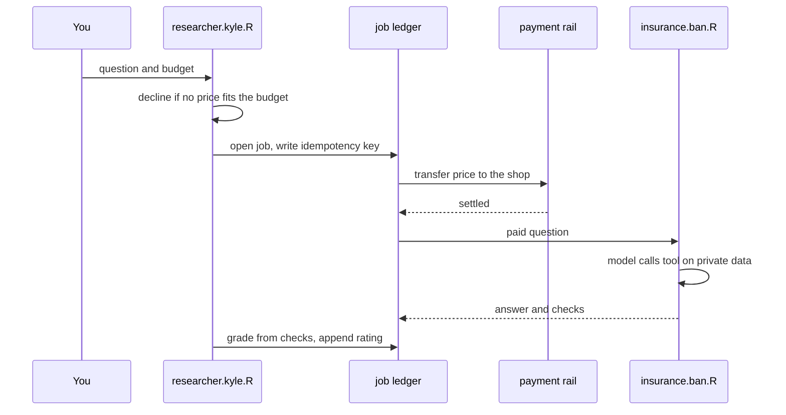
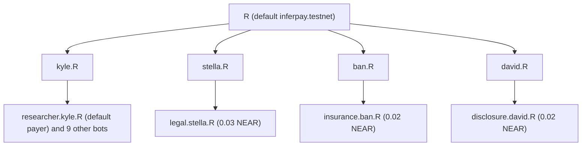

# InferPay

InferPay is a command-line agent that buys answers from specialist agents and pays them in NEAR. Each answer comes with machine checks computed from a dataset that only the specialist holds. The buyer grades the answer from those checks, and the grade becomes the specialist's reputation.

The problem: an AI agent that pays another agent for an answer cannot tell whether the answer is right. Agent marketplaces settle payment and collect a star rating, but the rating is someone's opinion. InferPay makes the specialist return checks the buyer can read line by line ("revenue claimed 86.0T, filing says 86.1T, mismatch"). The specialist keeps its data, and the buyer never pays more than its budget.

## What runs today

| Part | Without keys | With keys |
| --- | --- | --- |
| Routing, budget decline, hire, checks, grade, reputation | Real. Runs locally. | Same code. |
| Answers | `inference=stub`: replays 6 recorded questions. Any other question stops before payment. | `inference=near-ai`: NEAR AI Cloud, model `z-ai/glm-5.3-flash`, any question. Tested live on 2026-11-13. |
| Payment | `payment=mock`: writes a local receipt. No NEAR moves. | `payment=near-intents`: one transfer through a NEAR Intents agent grant. Mainnet only. |
| Accounts | Names derived from the root `inferpay.testnet`. Nothing is created on chain. | Names derived from `INFERPAY_ROOT_ACCOUNT`. |

The first line of every command prints the active rails, for example `rails: payment=mock inference=stub`.

## Try it without keys

You need Node 22.18 or newer. The commands take about two minutes.

1. Install the dependencies.

	```sh
	npm install
	```

2. Ask the insurance specialist a question.

	```sh
	npx inferpay ask "Does this policy cover an outpatient MRI?" --budget 0.10
	```

	You see the buyer route the question, pay 0.02 NEAR, and receive an answer with one check:

	```
	rails: payment=mock inference=stub
	decide    outsource to insurance
	          why     needs the private policy schedule the consumer does not hold
	pay       settled  0.02 NEAR
	          from    researcher.kyle.inferpay.testnet
	          to      insurance.ban.inferpay.testnet
	          via     mock receipt (no NEAR moved)
	          job     job_01M7BETHF0FM5SPDRPWWVSEJWK
	answer    Outpatient MRI is covered at a 20 percent copay.
	checks    match     outpatient MRI            covered   (Policy schedule §4.2. Outpatient MRI is covered at 20% copay.)
	rate      5/5
	```

	The `via` line names the rail that ran. On `payment=mock`, the payment is a local receipt. The `job` line is the id that `npx inferpay job <id>` and `npx inferpay resume <id>` take.

3. Ask the filings specialist. This recording contains a wrong revenue figure on purpose.

	```sh
	npx inferpay ask "What was Samsung's Q3 2025 operating profit?" --budget 0.10
	```

	The cross-check catches the wrong figure, and the grade drops to 4/5:

	```
	answer    Operating profit matches across both documents: KRW 12.2T.
	checks    match     operating profit Q3 2025  12.2T KRW   (Samsung Electronics Q3 2025 earnings release)
	          mismatch  revenue Q3 2025           86.0T KRW   ref 86.1T KRW (-0.12%)
	rate      4/5 (1 of 2 checks needed correction)
	```

	Samsung's Q3 2025 earnings release reports revenue of 86.1T KRW and operating profit of 12.2T KRW. The recorded claim of 86.0T KRW is 0.12 percent away, and `TOLERANCE_PCT` in `src/providers/disclosure/crossValidate.ts` is 0.05 percent.

4. Ask with a budget below every price.

	```sh
	npx inferpay ask "What was Samsung's Q3 2025 operating profit?" --budget 0.01
	```

	The buyer declines before any payment:

	```
	decide    declined
	          why     Cheapest fitting provider costs 0.02 NEAR, budget is 0.01 NEAR.
	```

5. Ask a question that has no recording.

	```sh
	npx inferpay ask "Schedule a meeting on Monday" --budget 0.10
	```

	The command exits with code 1. It prints `No NEAR moved.`, lists the recorded questions, and tells you to set `NEAR_AI_API_KEY` to ask anything.

6. List the specialists again.

	```sh
	npx inferpay providers
	```

	The `JOBS` and `RATING` columns now count the jobs you ran. Reputation is recomputed from the job files under `.inferpay/jobs`.

These recorded questions work without keys:

- `What was Samsung's Q3 2025 operating profit?`
- `Does Samsung Electronics' Q3 2025 operating profit in the earnings release match the quarterly report?`
- `What was Samsung's Q3 2025 capex?`
- `Does this NDA's unlimited indemnification clause fail our playbook?`
- `Does this policy cover an outpatient MRI?`
- `Does this policy cover cosmetic surgery?`

Matching ignores case, extra spaces, and the final `?`.

## Ask anything with NEAR AI

1. Get a NEAR AI Cloud API key. See Q-000 in [HACKATHON.md](HACKATHON.md) for the free credits.
2. Create `.env` in the repository root. The CLI reads `./.env` on start, and git ignores it.

	```sh
	echo 'NEAR_AI_API_KEY=your-key' > .env
	```

3. Ask any question.

	```sh
	npx inferpay ask "What copay do I pay for an outpatient MRI under this policy?" --budget 0.10
	```

	A run on 2026-11-13 printed this:

	```
	rails: payment=mock inference=near-ai
	decide    outsource to insurance
	          why     The copay depends on the private policy schedule, which the insurance provider holds and I do not.
	pay       settled  0.02 NEAR
	          from    researcher.kyle.inferpay.testnet
	          to      insurance.ban.inferpay.testnet
	          via     mock receipt (no NEAR moved)
	          job     job_01M7BET5CRDKWBR7G6FQ0JMD2F
	answer    Under this policy, your copay for an outpatient MRI is 20%.
	checks    match     outpatient MRI coverage   covered   (Policy schedule §4.2. Outpatient MRI is covered at 20% copay.)
	          mismatch  MRI copay                 15   ref 20 (Policy schedule §4.2. Outpatient MRI copay is 20 percent.)
	rate      4/5 (1 of 2 checks needed correction)
	```

	In this run the specialist model first claimed a 15 percent copay. The check against the private schedule returned 20, the model corrected its answer, and the grade dropped to 4/5 for the wrong claim. Model output varies between runs. A question with no private data behind it, such as `What is the capital of France?`, prints `decide    answer locally` and pays nothing.

The first line changes to `inference=near-ai`. The routing model picks a specialist from the listings. The specialist model calls its tool (`cross_validate_numbers`, `flag_clauses`, or `lookup_coverage`), and the tool returns the checks. The tool schema lists the key names in the private file, such as the topic `mri-copay`, but not the values. The tool reads the private JSON file, and the model sees only the tool result.

Both roles default to `z-ai/glm-5.3-flash`. Override them with `NEAR_AI_CONSUMER_MODEL` and `NEAR_AI_PROVIDER_MODEL`.

## How the parts fit



1. `src/consumer/decide.ts` drops every listing priced above the budget. If none is left, the buyer declines. Otherwise the routing model picks a specialist.
2. `src/market/index.ts` writes an append-only job file under `.inferpay/jobs`. It stores the idempotency key before the transfer, so a retry sends the same key and cannot pay twice. `npx inferpay resume <jobId>` continues a job that stopped on a pending payment.
3. The specialist in `src/providers/<id>/` answers through one tool. The tool compares the model's claims with the private file (`samsung-q3-2025.json`, `playbook.json`, or `coverage.json`) and returns checks.
4. `src/consumer/grade.ts` starts at 5 stars and subtracts 1 for each `mismatch`, down to 1. An answer with no checks, or with only `unverifiable` checks, scores 3. A `raised` flag is the legal specialist rejecting a clause, so it does not subtract.
5. `npx inferpay providers` averages the ratings in the job files.

## How NEAR fits

**Named accounts.** Every account derives from one root account `R` that the team owns. Each person is a sub-account of the root. Each bot or shop is a sub-account of its person.



A NEAR parent account has no control over a sub-account after it creates it. `stella.R` cannot spend from `insurance.ban.R`. `npx inferpay wallets` prints the tree. `src/roster.ts` derives the names. This repository does not create the accounts.

**NEAR Intents.** `src/payment/near-intents.ts` uses `@near-intents-agent-api/sdk`. It calls `forGrant` with the grant token and transfers `nep141:wrap.near` to the shop. The owner signs the agent's policy once, and no one signs each hire. The policy sets the allowed actions, assets, destinations, and amounts. InferPay checks only that each price fits the budget of that question.

**NEAR AI Cloud.** `src/inference/near-ai.ts` calls the OpenAI-compatible API at `https://cloud-api.near.ai/v1` with tool calling.

## Set the live payment rail

Set all three payment variables together. A partial set stops startup.

```
NEAR_INTENTS_AGENT_API_KEY=
INFERPAY_AGENT_ID=
INFERPAY_GRANT_TOKEN=
INFERPAY_ROOT_ACCOUNT=
```

- `INFERPAY_ROOT_ACCOUNT` is required on the live rail. It must be a mainnet account you own, such as `yourteam.near`. NEAR Intents has no testnet, so a root that ends in `.testnet` stops startup.
- The agent's policy must list each shop account as a destination.
- The three prices sum to 0.07 NEAR. NEAR has 24 decimal places, so 0.02 NEAR is `20000000000000000000000` atomic units.
- `INFERPAY_NEAR_ASSET` overrides the asset. The default is `nep141:wrap.near`.
- The SDK declares Node 24 in its `engines` field.

Other variables: `INFERPAY_DATA_DIR` moves `.inferpay`. `INFERPAY_MOCK_CHAOS=uncertain-once` makes the mock rail return an uncertain status once, so you can try `resume`.

## Limits

- No live payment has run yet. The live rail type-checks against the SDK, and its tests cover only the amount conversion and the status mapping.
- All ten Kyle bots spend through one Intents agent and one grant. `--from clerk` changes the buyer recorded in the job file and the `from` line. It does not change the paying agent.
- The buyer and the specialists run in one process. The buyer code receives only the answer and the checks, but no process or machine boundary enforces that.
- Payment happens before the answer. If the specialist fails three times, the job is abandoned without a refund.
- Reputation lives in local job files. It is not on chain.

## Develop

```sh
npm run check
```

`npm run check` runs the type check, the linter, and the tests.

| Path | Contents |
| --- | --- |
| `bin/inferpay.js` | CLI entry. Loads `./.env`. |
| `src/cli/` | Argument parsing and terminal output. |
| `src/consumer/` | Routing, budget decline, and grading. |
| `src/market/` | Job ledger, hire state machine, and reputation. |
| `src/payment/` | Mock rail and NEAR Intents rail. |
| `src/inference/` | Stub recordings and the NEAR AI client. |
| `src/providers/` | The three specialists, their tools, and their private data. |
| `src/roster.ts` | Account names derived from the root. |

## Hackathon notes

- Event: NEAR HACKATHON. Track: `agents` (Agent Economy).
- Timeline: the first commit is dated 2026-10-24, after the announcement on 2026-10-19 (Q-001).
- Libraries: `@near-intents-agent-api/sdk`, `openai` (as the client for NEAR AI Cloud), `zod`, TypeScript, and ESLint (Q-005).
- AI assistance: the code and docs were written with Claude Code.
- License: MIT. See [LICENSE](LICENSE).
