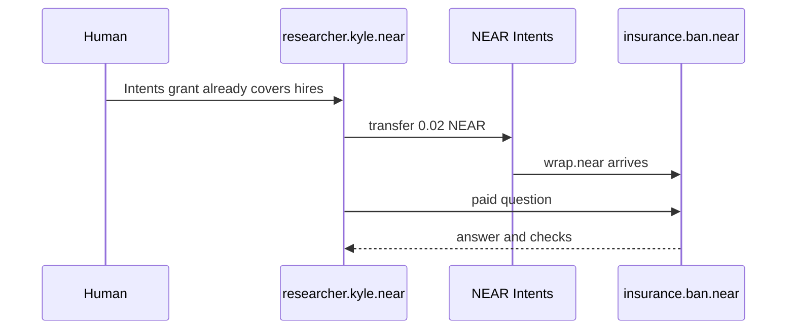
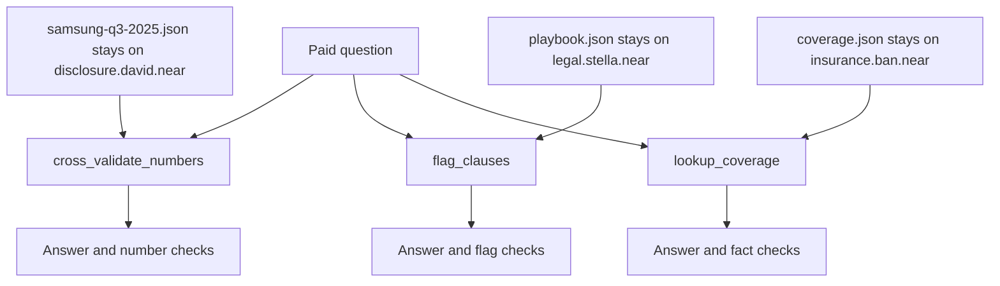

# InferPay

A buyer bot pays a specialist bot in NEAR, then receives an answer and checks. The specialist keeps the dataset.

Kyle has ten buyer bots under `kyle.near`. Stella, Ban, and David each sell one specialty. The default buyer is `researcher.kyle.near`. An Intents grant pays the shop, so you do not sign each hire.

## Try the walkthrough

No API keys. Node 22.18 or newer.

```sh
npm install
npx inferpay wallets
npx inferpay ask "Does this policy cover an outpatient MRI?" --budget 0.10
```

`wallets` prints the named account tree. The ask pays 0.02 NEAR from `researcher.kyle.near` to `insurance.ban.near` and prints a coverage answer with checks.

The first line of every command names the rails. In this walkthrough that line is `rails: payment=mock inference=stub`.

Film three terminal pictures. Leave the command and the output in the same frame.

1. `npx inferpay wallets`. The picture shows ten bots under `kyle.near` and three shop accounts.
2. The MRI ask. The picture shows `from researcher.kyle.near`, `to insurance.ban.near`, `via Intents grant`, and `rate 5/5`.
3. The Samsung ask. The picture shows `to disclosure.david.near`, a revenue mismatch, and `rate 4/5`.

## Read the first line

`payment=mock` writes a local receipt. It does not move mainnet NEAR. The `from`, `to`, and `via` lines are the accounts a live Intents grant would use.

`inference=stub` does not call a model. `src/inference/stub.ts` picks a recorded sentence by keyword. MRI, Samsung filings, and unlimited indemnification are the three recordings. A question outside those keywords fails with `no-fixture`.

The checks under the sentence are not recorded. The specialist tool reads a private JSON file and grades the claim. `coverage.json`, `playbook.json`, and `samsung-q3-2025.json` stay on the specialist.

Set `NEAR_AI_API_KEY` when you want the same tools to run under a model. The client calls `https://cloud-api.near.ai/v1`. The default consumer model is `z-ai/glm-5.2`. The default provider model is `zai-org/GLM-5.1-FP8`. Leave the key unset to keep the recordings.

## Walk through the specialists

`npx inferpay providers` lists the shops. Prices are 0.02 NEAR, 0.03 NEAR, and 0.02 NEAR. A budget of 0.10 NEAR covers each price. A budget of 0.01 NEAR declines and writes no job file.

```sh
npx inferpay wallets
```

Picture. Ten Kyle bots and three shops. `researcher.kyle.near` is the default payer. `insurance.ban.near` is Ban's shop.

```
rails: payment=mock inference=stub
PERSON  PARENT       BOT         ACCOUNT                ROLE
kyle    kyle.near    researcher  researcher.kyle.near   default payer
kyle    kyle.near    writer      writer.kyle.near       payer
kyle    kyle.near    trader      trader.kyle.near       payer
kyle    kyle.near    analyst     analyst.kyle.near      payer
kyle    kyle.near    clerk       clerk.kyle.near        payer
kyle    kyle.near    scout       scout.kyle.near        payer
kyle    kyle.near    editor      editor.kyle.near       payer
kyle    kyle.near    buyer       buyer.kyle.near        payer
kyle    kyle.near    reviewer    reviewer.kyle.near     payer
kyle    kyle.near    assistant   assistant.kyle.near    payer
stella  stella.near  legal       legal.stella.near      specialist
ban     ban.near     insurance   insurance.ban.near     specialist
david   david.near   disclosure  disclosure.david.near  specialist
```

```sh
npx inferpay providers
```

Picture. Three specialties and their prices. Disclosure and insurance are 0.02 NEAR. Legal is 0.03 NEAR. No jobs yet, so each rating is unrated.

```
rails: payment=mock inference=stub
ID          OWNER        PAY TO                 SPECIALTY                                          PRICE      JOBS  RATING
disclosure  david.near   disclosure.david.near  Disclosure analysis, number cross-check            0.02 NEAR  0     unrated
legal       stella.near  legal.stella.near      Contract clause review against a private playbook  0.03 NEAR  0     unrated
insurance   ban.near     insurance.ban.near     Private policy schedule: MRI, copay, exclusions    0.02 NEAR  0     unrated
```

Ask the filings specialist.

```sh
npx inferpay ask "What was Samsung's Q3 2025 operating profit?" --budget 0.10
```

Picture. 0.02 NEAR moves from `researcher.kyle.near` to `disclosure.david.near` through an Intents grant. Operating profit matches. Revenue mismatches. The score is 4/5.

```
rails: payment=mock inference=stub
decide    outsource to disclosure
          why     needs filing figures the consumer does not hold
pay       settled  0.02 NEAR
          from    researcher.kyle.near
          to      disclosure.david.near
          via     Intents grant
answer    Operating profit matches across both documents: KRW 12.1T.
checks    match     operating profit Q3 2025  12.1T KRW   (quarterly report, p.14)
          mismatch  revenue Q3 2025           79.0T KRW   ref 79.1T KRW (-0.13%)
rate      4/5 (1 of 2 checks needed correction)
```

The sample filing is Samsung Electronics Q3 2025. Operating profit is 12.1T KRW. Revenue is 79.1T KRW. The recorded claim of 79.0T KRW is 0.13 percent away. `TOLERANCE_PCT` in `src/providers/disclosure/crossValidate.ts` is 0.05 percent, so that check is a mismatch.

Ask the playbook specialist.

```sh
npx inferpay ask "Does this NDA's unlimited indemnification clause fail our playbook?" --budget 0.10
```

Picture. 0.03 NEAR moves from `researcher.kyle.near` to `legal.stella.near`. The playbook raises uncapped indemnity. The score is 4/5.

```
rails: payment=mock inference=stub
decide    outsource to legal
          why     needs the private clause playbook the consumer does not hold
pay       settled  0.03 NEAR
          from    researcher.kyle.near
          to      legal.stella.near
          via     Intents grant
answer    The unlimited indemnification clause fails the playbook.
checks    raised    uncapped indemnity        The playbook rejects unlimited indemnification. Cap it or delete it.
rate      4/5 (1 of 1 checks needed correction)
```

`src/providers/legal/data/playbook.json` rejects unlimited indemnification.

Ask the coverage specialist.

```sh
npx inferpay ask "Does this policy cover an outpatient MRI?" --budget 0.10
```

Picture. 0.02 NEAR moves from `researcher.kyle.near` to `insurance.ban.near` through an Intents grant. Outpatient MRI matches the schedule. The score is 5/5.

```
rails: payment=mock inference=stub
decide    outsource to insurance
          why     needs the private policy schedule the consumer does not hold
pay       settled  0.02 NEAR
          from    researcher.kyle.near
          to      insurance.ban.near
          via     Intents grant
answer    Outpatient MRI is covered at a 20 percent copay.
checks    match     outpatient MRI            covered   (Policy schedule §4.2. Outpatient MRI is covered at 20% copay.)
rate      5/5
```

`src/providers/insurance/data/coverage.json` covers outpatient MRI at a 20 percent copay. Cosmetic surgery is excluded.

Ask the same coverage question from another Kyle bot.

```sh
npx inferpay ask "Does this policy cover an outpatient MRI?" --budget 0.10 --from clerk
```

Picture. The same MRI payment, with `from` changed to `clerk.kyle.near`. The shop is still `insurance.ban.near`.

```
rails: payment=mock inference=stub
decide    outsource to insurance
          why     needs the private policy schedule the consumer does not hold
pay       settled  0.02 NEAR
          from    clerk.kyle.near
          to      insurance.ban.near
          via     Intents grant
answer    Outpatient MRI is covered at a 20 percent copay.
checks    match     outpatient MRI            covered   (Policy schedule §4.2. Outpatient MRI is covered at 20% copay.)
rate      5/5
```

Ask the filings question with a budget under the price.

```sh
npx inferpay ask "What was Samsung's Q3 2025 operating profit?" --budget 0.01
```

Picture. The buyer declines. The cheapest shop is 0.02 NEAR and the budget is 0.01 NEAR. No pay line appears.

```
rails: payment=mock inference=stub
decide    declined
          why     Cheapest fitting provider costs 0.02 NEAR, budget is 0.01 NEAR.
```

The buyer grades the checks. No checks scores 3. Each mismatch or raised flag subtracts 1 from 5. The score stays at least 1. An unverifiable figure does not subtract. A clear flag does not subtract.

A job is an append-only file under `.inferpay/jobs`. `npx inferpay providers` recomputes reputation from those files. `.inferpay/` is gitignored.

## What the finished rails do

The commands stay the same. The first line changes when the keys are set.

With the four payment variables set, `payment=near-intents`. `src/payment/near-intents.ts` calls `forGrant` and transfers `nep141:wrap.near`. You do not sign that hire. The spend cap is the Intents grant, not a second cap in this repository. The three shop prices sum to 0.07 NEAR, so a demo grant of 0.10 NEAR covers one pass over disclosure, legal, and insurance.

With `NEAR_AI_API_KEY` set, `inference=near-ai`. The model may call `cross_validate_numbers`, `flag_clauses`, or `lookup_coverage`. The JSON files still stay on the specialist. The model does not receive the raw dataset as the answer.

This repository does not call CreateAccount. `npx inferpay wallets` prints names. It does not open `researcher.kyle.near` on mainnet. A relayer and function-call keys need those accounts to exist, so they are not in this repository. NEAR Intents has no testnet. A live grant runs on mainnet.

Picture. One parent per person. Kyle's ten bots hang under `kyle.near`. Each shop hangs under its own parent.

```mermaid
flowchart TD
  kyle["kyle.near"]
  kyle --> researcher["researcher.kyle.near default payer"]
  kyle --> writer["writer.kyle.near"]
  kyle --> trader["trader.kyle.near"]
  kyle --> analyst["analyst.kyle.near"]
  kyle --> clerk["clerk.kyle.near"]
  kyle --> scout["scout.kyle.near"]
  kyle --> editor["editor.kyle.near"]
  kyle --> buyer["buyer.kyle.near"]
  kyle --> reviewer["reviewer.kyle.near"]
  kyle --> assistant["assistant.kyle.near"]
  stella["stella.near"]
  stella --> legal["legal.stella.near playbook specialist receives 0.03 NEAR"]
  ban["ban.near"]
  ban --> insurance["insurance.ban.near coverage specialist receives 0.02 NEAR"]
  david["david.near"]
  david --> disclosure["disclosure.david.near filings specialist receives 0.02 NEAR"]
```



Picture. The grant pays 0.02 NEAR before the shop answers. The human does not sign this hire.



Picture. The paid question hits a tool. The JSON file stays on the shop account. The buyer receives checks, not the file.



The marketplace writes the idempotency key into the job file before the transfer. A retry sends that same key. A new key would pay again.

## Why the accounts are named

NEAR named accounts form a tree. `researcher.kyle.near` is a child of `kyle.near`. `legal.stella.near` is a child of `stella.near`. An Ethereum address is one hex string. It cannot name a child that way.

The buyer and the shop are different parents. Stella cannot spend Ban's shop account. That separation is the named account tree. This repository derives the names in `src/roster.ts`. It does not create the accounts.

The tracks this project fits are `agents`, `swarms`, and `security`. Ten bots hire three shops through one grant. The grant is the spend limit. This project does not use a TEE, so it does not fit `privacy`.

## Set the live rails

Copy `.env.example` to `.env`. Do not commit `.env`.

Set all four payment variables together. Leave all four unset to stay on the mock rail. A partial set stops startup.

```
NEAR_INTENTS_AGENT_API_KEY
INFERPAY_AGENT_ID
INFERPAY_GRANT_TOKEN
INFERPAY_PARENT_ACCOUNT
```

`INFERPAY_PARENT_ACCOUNT` is Kyle's Meteor named account, such as `yourname.near`. It must contain a dot. When the four variables are set, InferPay derives Kyle's ten bot names from that parent. Shop names stay `legal.stella.near`, `insurance.ban.near`, and `disclosure.david.near`. If the parent equals `stella.near`, `ban.near`, or `david.near`, startup refuses the overlap.

`INFERPAY_NEAR_ASSET` overrides the asset id. The default is `nep141:wrap.near`. NEAR has 24 decimal places, so 0.02 NEAR is `20000000000000000000000` atomic units.

`INFERPAY_DATA_DIR` overrides `.inferpay`. `INFERPAY_MOCK_CHAOS` applies only to the mock rail.

The live Intents SDK requires Node 24. The mock walkthrough runs on Node 22.18 or newer.

Other commands:

```sh
npx inferpay resume <jobId>
npx inferpay job <jobId>
```

`resume` continues a job that stopped on a pending payment. It reuses the idempotency key. `job` prints the append-only log.
