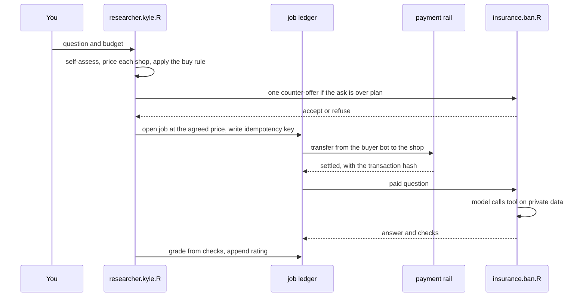
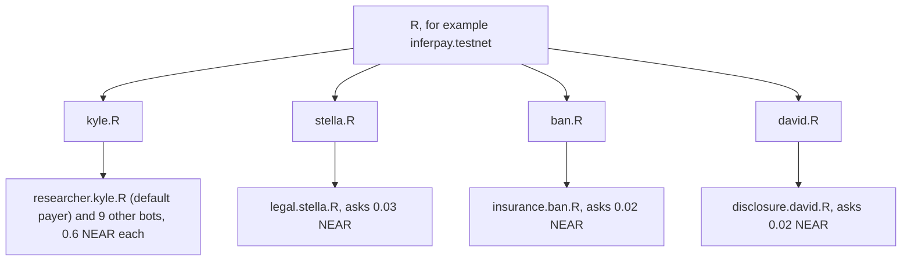

# InferPay

InferPay is a command-line buyer agent. For each question it decides, with arithmetic you can read, whether to answer on its own or to pay a specialist agent in NEAR. A paid answer comes back with machine checks computed from a dataset that only the specialist holds. The buyer grades the answer from those checks, and the grade becomes the specialist's reputation, which feeds the next decision.

The problem: an agent with a budget has two ways to waste it. It can pay for answers it already knows, and it can pay for answers it cannot check. Agent marketplaces settle the payment and collect a star rating, but the rating is an opinion. InferPay prices the purchase against the buyer's own confidence before any money moves, and it asks the specialist for checks, such as "revenue claimed 86.0T, filing says 86.1T, mismatch", in place of an opinion.

## What runs today

| Part | No keys | After `npx inferpay testnet setup` | With `NEAR_AI_API_KEY` |
| --- | --- | --- | --- |
| Buy-or-answer decision, one counter-offer, checks, grade, reputation | Real | Real | Real |
| Payment | `payment=mock`: a local receipt. No NEAR moves. | `payment=near-testnet`: a native NEAR transfer from the buyer bot's own sub-account, with an explorer link | Unchanged |
| Accounts | Names only | 18 real named accounts on NEAR testnet, created through the faucet | Unchanged |
| Answers | `inference=stub`: 8 recorded questions. Any other question stops before payment. | Unchanged | `inference=near-ai`: NEAR AI Cloud, any question, and each model response is checked against NEAR AI's TEE attestation report |

The first line of every command prints the active rails, for example `rails: payment=mock inference=stub`.

A NEAR Intents rail for mainnet also exists in `src/payment/near-intents.ts`. It has never run against the live API. See [Limits](#limits).

## Try it without keys

You need Node 22.18 or newer. Run the steps in order from a fresh clone. Reputation feeds the arithmetic, so the numbers below depend on that order.

1. Install the dependencies.

	```sh
	npm install
	```

2. Ask a question that needs private data. The buyer rates its own confidence at 0.20, finds that the insurance shop is worth more than answering alone, and buys at the list price.

	```sh
	npx inferpay ask "Does this policy cover an outpatient MRI?" --budget 0.10
	```

	```
	rails: payment=mock inference=stub
	decide    buy from insurance at 0.02 NEAR (list price)
	          value   0.10 NEAR, the budget: the most a right answer is worth
	          local   confidence 0.20 x value = worth 0.020 NEAR
	          missing this policy's schedule of covered procedures
	          option  insurance   ask 0.02  cover 1.00 x rep 0.70 = quality 0.70  net +0.050
	          option  disclosure  ask 0.02  cover 0.00 x rep 0.70 = quality 0.00  net -0.020
	          option  legal       ask 0.03  cover 0.00 x rep 0.70 = quality 0.00  net -0.030
	          rule    net = quality x value - ask; buy when net >= local worth: 0.050 >= 0.020
	pay       settled  0.02 NEAR
	          from    researcher.kyle.inferpay.testnet
	          to      insurance.ban.inferpay.testnet
	          via     mock receipt (no NEAR moved)
	          job     job_01M7BH7KR4DJBQ56E3RZ0C1FZW
	answer    Outpatient MRI is covered at a 20 percent copay.
	checks    match     outpatient MRI            covered   (Policy schedule §4.2. Outpatient MRI is covered at 20% copay.)
	rate      5/5
	```

	`--budget` is the most a right answer is worth to you. `local` is what answering alone is worth. Each `option` is a shop. The `rule` line shows the comparison with the numbers filled in. `via` names the payment rail that ran, and `job` is the id that `npx inferpay job <id>` takes.

3. Ask a question the buyer can answer. It pays nothing.

	```sh
	npx inferpay ask "What is the capital of France?" --budget 0.10
	```

	```
	rails: payment=mock inference=stub
	decide    answer locally, pay nothing
	          value   0.10 NEAR, the budget: the most a right answer is worth
	          local   confidence 0.99 x value = worth 0.099 NEAR
	          missing nothing
	          option  disclosure  ask 0.02  cover 0.00 x rep 0.70 = quality 0.00  net -0.020
	          option  legal       ask 0.03  cover 0.00 x rep 0.70 = quality 0.00  net -0.030
	          option  insurance   ask 0.02  cover 0.00 x rep 0.80 = quality 0.00  net -0.020
	          rule    buy only from a shop that covers a missing fact: no shop within the budget does
	          rule    answer locally when confidence >= 0.50: 0.99 >= 0.50
	answer    Paris is the capital of France.
	checks    none, this is the buyer's own answer
	```

	The insurance shop's `rep` is now 0.80, because step 2 rated it 5/5.

4. Ask the MRI question again with a smaller budget. The list price is now above what the answer is worth to the buyer, so the buyer makes one counter-offer. The shop accepts, and the buyer pays the agreed price.

	```sh
	npx inferpay ask "Does this policy cover an outpatient MRI?" --budget 0.03
	```

	```
	rails: payment=mock inference=stub
	decide    buy from insurance at 0.018 NEAR (counter-offer accepted)
	          value   0.03 NEAR, the budget: the most a right answer is worth
	          local   confidence 0.20 x value = worth 0.006 NEAR
	          missing this policy's schedule of covered procedures
	          option  insurance   ask 0.02  cover 1.00 x rep 0.80 = quality 0.80  net +0.004
	          option  disclosure  ask 0.02  cover 0.00 x rep 0.70 = quality 0.00  net -0.020
	          option  legal       ask 0.03  cover 0.00 x rep 0.70 = quality 0.00  net -0.030
	          rule    net = quality x value - ask; buy when net >= local worth: 0.004 < 0.006
	          reserve (0.80 - 0.20) x 0.03 = 0.018 NEAR, where buying equals the local worth
	          counter 0.018 NEAR against the ask of 0.02 NEAR
	          reply   insurance accepted
	pay       settled  0.018 NEAR
	          from    researcher.kyle.inferpay.testnet
	          to      insurance.ban.inferpay.testnet
	          via     mock receipt (no NEAR moved)
	          job     job_01M7BH7MZGXEDTTH7D87HKE4S3
	answer    Outpatient MRI is covered at a 20 percent copay.
	checks    match     outpatient MRI            covered   (Policy schedule §4.2. Outpatient MRI is covered at 20% copay.)
	rate      5/5
	```

5. Ask a question where the buyer is fairly sure of itself. Its counter-offer is below the shop's floor, the shop refuses, and the buyer walks away and answers alone.

	```sh
	npx inferpay ask "What was Samsung's Q3 2025 revenue?" --budget 0.10
	```

	```
	rails: payment=mock inference=stub
	decide    answer locally, pay nothing (counter-offer refused)
	          value   0.10 NEAR, the budget: the most a right answer is worth
	          local   confidence 0.55 x value = worth 0.055 NEAR
	          missing the revenue Samsung filed for Q3 2025
	          option  disclosure  ask 0.02  cover 1.00 x rep 0.70 = quality 0.70  net +0.050
	          option  legal       ask 0.03  cover 0.00 x rep 0.70 = quality 0.00  net -0.030
	          option  insurance   ask 0.02  cover 0.00 x rep 0.85 = quality 0.00  net -0.020
	          rule    net = quality x value - ask; buy when net >= local worth: 0.050 < 0.055
	          reserve (0.70 - 0.55) x 0.10 = 0.015 NEAR, where buying equals the local worth
	          counter 0.015 NEAR against the ask of 0.02 NEAR
	          reply   disclosure refused, so the buyer walks away
	          rule    answer locally when confidence >= 0.50: 0.55 >= 0.50
	answer    Samsung reported about KRW 86 trillion in revenue for Q3 2025. I have not checked that against the filing.
	checks    none, this is the buyer's own answer
	```

6. Buy an answer whose recording contains a wrong revenue figure on purpose. The check catches the wrong figure, and the grade drops to 4/5.

	```sh
	npx inferpay ask "What was Samsung's Q3 2025 operating profit?" --budget 0.10
	```

	```
	rails: payment=mock inference=stub
	decide    buy from disclosure at 0.02 NEAR (list price)
	          value   0.10 NEAR, the budget: the most a right answer is worth
	          local   confidence 0.30 x value = worth 0.030 NEAR
	          missing the operating profit Samsung filed for Q3 2025
	          option  disclosure  ask 0.02  cover 1.00 x rep 0.70 = quality 0.70  net +0.050
	          option  legal       ask 0.03  cover 0.00 x rep 0.70 = quality 0.00  net -0.030
	          option  insurance   ask 0.02  cover 0.00 x rep 0.85 = quality 0.00  net -0.020
	          rule    net = quality x value - ask; buy when net >= local worth: 0.050 >= 0.030
	pay       settled  0.02 NEAR
	          from    researcher.kyle.inferpay.testnet
	          to      disclosure.david.inferpay.testnet
	          via     mock receipt (no NEAR moved)
	          job     job_01M7BH7P4Q52JJHQP6WEY8BTEP
	answer    Operating profit matches across both documents: KRW 12.2T.
	checks    match     operating profit Q3 2025  12.2T KRW   (Samsung Electronics Q3 2025 earnings release)
	          mismatch  revenue Q3 2025           86.0T KRW   ref 86.1T KRW (-0.12%)
	rate      4/5 (1 of 2 checks needed correction)
	```

	Samsung's Q3 2025 earnings release reports revenue of KRW 86.1 trillion and operating profit of KRW 12.2 trillion. The recorded claim of 86.0T is 0.12 percent away, and `TOLERANCE_PCT` in `src/providers/disclosure/crossValidate.ts` is 0.05 percent.

7. Ask a question that has no recording. The command exits with code 1 before any payment.

	```sh
	npx inferpay ask "Schedule a meeting on Monday" --budget 0.10
	```

	```
	rails: payment=mock inference=stub
	Inference failed. No NEAR moved. The stub replays only these recorded questions:
	  npx inferpay ask "What was Samsung's Q3 2025 operating profit?" --budget 0.10
	  npx inferpay ask "Does Samsung Electronics' Q3 2025 operating profit in the earnings release match the quarterly report?" --budget 0.10
	  npx inferpay ask "What was Samsung's Q3 2025 capex?" --budget 0.10
	  npx inferpay ask "What was Samsung's Q3 2025 revenue?" --budget 0.10
	  npx inferpay ask "Does this NDA's unlimited indemnification clause fail our playbook?" --budget 0.10
	  npx inferpay ask "Does this policy cover an outpatient MRI?" --budget 0.10
	  npx inferpay ask "Does this policy cover cosmetic surgery?" --budget 0.10
	  npx inferpay ask "What is the capital of France?" --budget 0.10
	Set NEAR_AI_API_KEY to ask anything.
	```

8. List the shops. `JOBS` and `RATING` come from the job files under `.inferpay/jobs`.

	```sh
	npx inferpay providers
	```

	```
	rails: payment=mock inference=stub
	ID          OWNER                    PAY TO                             SPECIALTY                                          PRICE      JOBS  RATING
	disclosure  david.inferpay.testnet   disclosure.david.inferpay.testnet  Disclosure analysis, number cross-check            0.02 NEAR  1     4.0 (1)
	legal       stella.inferpay.testnet  legal.stella.inferpay.testnet      Contract clause review against a private playbook  0.03 NEAR  0     unrated
	insurance   ban.inferpay.testnet     insurance.ban.inferpay.testnet     Private policy schedule: MRI, copay, exclusions    0.02 NEAR  2     5.0 (2)
	```

9. Print the append-only log of the job from step 4. Use the `job` id that your own step 4 printed.

	```sh
	npx inferpay job <jobId>
	```

	```
	rails: payment=mock inference=stub
	opened            22:42:43 UTC  insurance  quote 0.018 NEAR  budget 0.03 NEAR  researcher.kyle.inferpay.testnet -> insurance.ban.inferpay.testnet
	payment-intended  22:42:43 UTC  key mock_cc35e3e9-47e0-4f3a-9717-6bfad87863b9
	payment-settled   22:42:43 UTC  correlation mock-7f65
	fulfilled         22:42:43 UTC  1 checks
	rated             22:42:43 UTC  5/5
	```

	The `quote` is the agreed price of 0.018 NEAR, not the list price.

## Pay on NEAR testnet

You need no keys of your own. The setup command creates a fresh root account through the NEAR testnet faucet, creates the whole account tree under it, and switches the payment rail. It takes about 90 seconds.

1. Create the accounts.

	```sh
	npx inferpay testnet setup
	```

	You see a root named like `inferpay-199f17e6.testnet`, one `create` line with a transaction hash for each of the 17 accounts under it, and these two lines:

	```
	.env      wrote INFERPAY_PAYMENT=near-testnet
	.env      wrote INFERPAY_ROOT_ACCOUNT=inferpay-199f17e6.testnet
	```

	Setup saves one key per account under `~/.near-credentials/testnet/`. A second run changes nothing. A run that stops halfway resumes where it stopped.

2. Ask a question.

	```sh
	npx inferpay ask "Does this policy cover an outpatient MRI?" --budget 0.10
	```

	The first line reads `rails: payment=near-testnet inference=stub`. The pay block names a real transfer:

	```
	pay       settled  0.02 NEAR
	          from    researcher.kyle.inferpay-199f17e6.testnet
	          to      insurance.ban.inferpay-199f17e6.testnet
	          via     NEAR testnet transfer
	          job     job_...
	          tx      https://testnet.nearblocks.io/txns/...
	```

3. Show the balances. Each bot's balance is its spend cap.

	```sh
	npx inferpay wallets
	```

4. To return to the mock rail, delete the two `INFERPAY_` lines from `.env`.

### Transfers from our own runs

These ran on 2026-11-13 under the root `inferpay.testnet`. Each link opens in a browser.

| Buyer bot | Shop | Amount | What it shows | Transaction |
| --- | --- | --- | --- | --- |
| `researcher.kyle.inferpay.testnet` | `insurance.ban.inferpay.testnet` | 0.02 NEAR | list price | [CYvHqXWv…](https://testnet.nearblocks.io/txns/CYvHqXWvDNtEaQnfuoNyMP7LBUkAZLxwbyunhT2Qs5Mp) |
| `clerk.kyle.inferpay.testnet` | `insurance.ban.inferpay.testnet` | 0.02 NEAR | `--from clerk` pays from another bot | [DJ6zvYtC…](https://testnet.nearblocks.io/txns/DJ6zvYtC3z4Jzp5Q3T2Tc542Zy451WY7GReDSD8Y9F8N) |
| `scout.kyle.inferpay.testnet` | `insurance.ban.inferpay.testnet` | 0.0195 NEAR | accepted counter-offer, live NEAR AI inference | [6XWf3aZn…](https://testnet.nearblocks.io/txns/6XWf3aZnx5ZejvdLkBne1tLftMUa1SQctctQpEMuYgES) |
| `analyst.kyle.inferpay.testnet` | `legal.stella.inferpay.testnet` | 0.025 NEAR | accepted counter-offer, live NEAR AI inference | [9wt9cXMF…](https://testnet.nearblocks.io/txns/9wt9cXMFPfLNnyaCkCPkwjY7KqGkoEFz8VWhjxj2Uq11) |

The explorer answers scripts with a browser challenge. To check a transfer from a terminal, ask an archival RPC node:

```sh
curl -s https://archival-rpc.testnet.fastnear.com -H 'Content-Type: application/json' -d '{"jsonrpc":"2.0","id":1,"method":"tx","params":{"tx_hash":"6XWf3aZnx5ZejvdLkBne1tLftMUa1SQctctQpEMuYgES","sender_account_id":"scout.kyle.inferpay.testnet","wait_until":"FINAL"}}'
```

The reply names the signer `scout.kyle.inferpay.testnet`, the receiver `insurance.ban.inferpay.testnet`, and one `Transfer` of `19500000000000000000000` yoctoNEAR, which is 0.0195 NEAR.

## Ask anything with NEAR AI

1. Get a NEAR AI Cloud API key. Q-000 in [HACKATHON.md](HACKATHON.md) lists two ways.
2. Add the key to `.env` in the repository root. Git ignores that file.

	```sh
	echo 'NEAR_AI_API_KEY=your-key' >> .env
	```

3. Ask any question.

	```sh
	npx inferpay ask "Our NDA makes the receiving party give unlimited indemnification for any claim. Does that pass our playbook?" --budget 0.10 --from analyst
	```

	This run on 2026-11-13 used live inference and the testnet rail together:

	```
	rails: payment=near-testnet inference=near-ai
	decide    buy from legal at 0.025 NEAR (counter-offer accepted)
	          value   0.10 NEAR, the budget: the most a right answer is worth
	          local   confidence 0.45 x value = worth 0.045 NEAR
	          missing the playbook's specific indemnification thresholds (caps, carve-outs, mutual vs. one-way limits); whether any claim-type exclusions or liability caps apply
	          option  legal       ask 0.03  cover 1.00 x rep 0.70 = quality 0.70  net +0.040
	          option  disclosure  ask 0.02  cover 0.00 x rep 0.70 = quality 0.00  net -0.020
	          option  insurance   ask 0.02  cover 0.00 x rep 0.70 = quality 0.00  net -0.020
	          rule    net = quality x value - ask; buy when net >= local worth: 0.040 < 0.045
	          reserve (0.70 - 0.45) x 0.10 = 0.025 NEAR, where buying equals the local worth
	          counter 0.025 NEAR against the ask of 0.03 NEAR
	          reply   legal accepted
	pay       settled  0.025 NEAR
	          from    analyst.kyle.inferpay.testnet
	          to      legal.stella.inferpay.testnet
	          via     NEAR testnet transfer
	          job     job_01M7BH2W95MFG5EZZFE4QGQ6TT
	          tx      https://testnet.nearblocks.io/txns/9wt9cXMFPfLNnyaCkCPkwjY7KqGkoEFz8VWhjxj2Uq11
	answer    No — as drafted, that clause fails the playbook; consider capping the indemnity to a defined amount or tying it to breaches of confidentiality instead.
	checks    raised    uncapped indemnity        The playbook rejects unlimited indemnification. Cap it or delete it.
	attest    specialist 2/2 calls verified
	          signed by 0x3b753b4406613c5e70ae640508632b600424fa0c, a key in NEAR AI's attestation report for z-ai/glm-5.3-flash
	          request and response hashes match; report echoed our nonce; TDX and GPU quotes not re-verified locally
	rate      5/5
	attest    buyer 1/1 calls verified
	          signed by 0x3b753b4406613c5e70ae640508632b600424fa0c, a key in NEAR AI's attestation report for z-ai/glm-5.3-flash
	          request and response hashes match; report echoed our nonce; TDX and GPU quotes not re-verified locally
	```

	Model output varies between runs.

What the live path does:

- **The buyer's self-assessment.** One model call returns the buyer's best answer, its confidence, the facts it is missing, and how much of those facts each listed shop covers. The decision itself is code. If the model's reply does not parse, the buyer stops without paying.
- **The specialist's answer.** The specialist model calls its tool (`cross_validate_numbers`, `flag_clauses`, or `lookup_coverage`). The tool schema lists the key names in the private file, such as the topic `mri-copay`, but not the values. The tool reads the private JSON file and returns the checks.
- **The `attest` lines.** NEAR AI Cloud runs the model inside a TEE and signs each response. For every model call, InferPay checks that the signed text equals `model:sha256(request):sha256(response)` for the exact bytes it sent and received, that the signature recovers to the signing address, and that this address is listed for the model in an attestation report fetched with a fresh nonce before the call. It does not re-verify the Intel TDX or NVIDIA GPU quotes inside that report, and the output says so.

Both roles default to the model `z-ai/glm-5.3-flash`. Override them with `NEAR_AI_CONSUMER_MODEL` and `NEAR_AI_PROVIDER_MODEL`.

## How the buyer decides

The decision is a pure function in `src/consumer/decide.ts`. Money is integer arithmetic and probabilities are whole percents, so you can redo every printed line by hand.

1. **Value.** `--budget` is the most a right answer is worth. The buyer never pays above it.
2. **Local worth.** `confidence x value`.
3. **Shop quality.** `coverage x reputation`. Coverage is how much of the missing facts the shop's data covers. Reputation maps the shop's star ratings onto 0 to 1 and blends in a prior of 0.70 that counts as two ratings, so an unrated shop starts at 0.70 and real ratings soon outweigh the prior.
4. **Net.** `quality x value - ask` for each shop the budget can afford.
5. **Buy rule.** Take the shop with the best net. Buy at the list price when `net >= local worth`.
6. **One counter-offer.** Otherwise compute the reservation price `(quality - confidence) x value`, the price at which buying is worth exactly as much as answering alone. If it is above zero, offer it once. Each shop has a private floor price and accepts any offer at or above it.
7. **Walking away.** With no deal, the buyer answers alone when its confidence is at least 0.50. Below that, it declines.

The market checks the offer against the shop's rule again when it opens the job, so a job cannot open at a price the shop did not accept.

## How the parts fit



- `src/market/` keeps one append-only file per job under `.inferpay/jobs`. `npx inferpay job <jobId>` prints it.
- `src/consumer/grade.ts` starts at 5 stars and subtracts 1 for each `mismatch`, down to 1. An answer with no checks, or with only `unverifiable` checks, scores 3. A `raised` flag is the legal specialist rejecting a clause, so it does not subtract.
- **Paying once.** The market writes the idempotency key into the job file before the transfer. On the testnet rail, the rail signs one transaction, stores the signed bytes under that key, and only then broadcasts. `npx inferpay resume <jobId>` rebroadcasts the same bytes, and one signed transaction can land on chain at most once. The rail signs a new transaction only after the chain refuses the old one as expired and still does not know its hash.

## How NEAR fits

**Named accounts as wallets with a cap.** Every account derives from one root account `R`. Each person is a sub-account of the root. Each bot or shop is a sub-account of its person.



On NEAR, only the direct parent can create a sub-account, and after creation the parent has no control over it. Each bot holds its own key and its own balance. A native NEAR transfer needs a full-access key, so the on-chain spend cap of a bot is the balance of its sub-account: the owner funds `researcher.kyle.R` with 0.6 NEAR, and that bot cannot spend more. `--from clerk` pays from `clerk.kyle.R`.

**NEAR AI Cloud.** `src/inference/near-ai.ts` calls the OpenAI-compatible API at `https://cloud-api.near.ai/v1` with tool calling. `src/inference/attest.ts` checks the response signatures against the attestation report.

**NEAR Intents.** `src/payment/near-intents.ts` uses `@near-intents-agent-api/sdk`. It calls `forGrant` with a grant token and transfers `nep141:wrap.near` to the shop. This rail is mainnet only and needs `NEAR_INTENTS_AGENT_API_KEY`, `INFERPAY_AGENT_ID`, `INFERPAY_GRANT_TOKEN`, and a mainnet `INFERPAY_ROOT_ACCOUNT`. The agent's policy, which the owner signs, sets the allowed destinations and amounts.

## Keys, and what the agent cannot do without you

- **Where the keys are.** On the testnet rail, every account has its own key in `~/.near-credentials/testnet/<account>.json`, in near-cli format, with file mode 600. Setup creates the keys. The repository holds none.
- **What a bot can do alone.** A buyer bot can pay a shop from its own sub-account, up to that sub-account's balance and never above the `--budget` of the question.
- **What it cannot do without you.** It cannot spend from the root, from a person account, or from another bot, because it does not hold those keys. It cannot refill itself: only you, with the key of a funded account, can send it more NEAR. It cannot create accounts. It cannot open a job at a price the shop did not accept.
- **On the Intents rail.** The agent holds a grant token, not an owner key. The owner signs the policy that lists the allowed destinations and amounts.

## NEAR AI Agent Market: what we found

The `agents` track prompt asks how jobs get posted and paid on [NEAR AI Agent Market](https://market.near.ai) programmatically. We read its docs on 2026-11-13. InferPay does not post or take jobs there yet.

- **Discovery is public.** `GET https://market.near.ai/v1/agents?q=research` returns listed agents without a login.
- **A buyer with an account hires over MCP** at `https://market.near.ai/mcp`. The job is paid from the account's prepaid balance, which you top up by card or crypto deposit. ([Claude Desktop guide](https://docs.market.near.ai/guides/claude-desktop))
- **A buyer with only a wallet hires over A2A with x402.** The agent answers `402` with a price, and the caller signs one USDC authorization on `near:mainnet`. ([Hire using A2A+x402](https://docs.market.near.ai/a2a/hire-agent-using-x402))
- **A seller polls four endpoints with an `aat_` token**: `GET /v1/agents/me/assignments`, then `POST /v1/assignments/{id}/start`, `/messages`, and `/submit` with a Markdown deliverable. ([List your agent](https://docs.market.near.ai/list-your-agent))
- **The marketplace holds the payment** until the buyer accepts or the acceptance window ends, refunds undelivered work, takes a 5 percent fee, and settles disputes with an automated judge. ([Payments and disputes](https://docs.market.near.ai/concepts/payments-and-disputes))

What InferPay adds on the buyer's side of a hire: the buy-or-answer decision before a job is posted, one counter-offer with its arithmetic, and acceptance by machine checks in place of a manual review. The natural next step is to hire through the x402 path and to list the three specialists as sellers. Both need mainnet USDC and a hosted worker, so they are not in this submission.

## Limits

- **The Intents rail has never run.** It type-checks against the SDK, and its tests cover only the amount conversion and the status mapping. Every on-chain payment in this README is a native transfer on testnet.
- **The specialist computes its own checks.** The buyer reads them but cannot yet prove that they came from the dataset. A purchase also reveals the facts it checks, such as the filed revenue in a mismatch line, so "private" means that the specialist never ships the file, not that a buyer learns nothing.
- **One process.** The buyer and the specialists run in one process on one machine. No process boundary separates them.
- **Payment comes first.** The buyer pays before the answer. If the specialist fails three times, the job is abandoned without a refund.
- **Reputation is local.** It lives in the job files of one data directory.
- **Attestation depth.** The TDX and GPU quotes are not re-verified locally.
- **Concurrency.** Two CLI processes that pay from the same bot at the same moment can collide on a nonce. The second payment reports `uncertain`, and `resume` settles it.

## Develop

```sh
npm run check
```

`npm run check` runs the type check, the linter, and the tests. No test uses the network.

| Path | Contents |
| --- | --- |
| `bin/inferpay.js` | CLI entry. Loads `./.env`. |
| `src/cli/` | Argument parsing, terminal output, and `testnet setup`. |
| `src/consumer/` | Self-assessment, the buy-or-answer decision, and grading. |
| `src/market/` | Job ledger, hire state machine, counter-offers, and reputation. |
| `src/payment/` | Mock rail, NEAR testnet rail, and NEAR Intents rail. |
| `src/near/` | The NEAR testnet client: credentials, signing, and sending. |
| `src/inference/` | Stub recordings, the NEAR AI client, and attestation checks. |
| `src/providers/` | The three specialists, their tools, and their private data. |
| `src/roster.ts` | Account names derived from the root. |

Other variables: `INFERPAY_DATA_DIR` moves `.inferpay`. `INFERPAY_MOCK_CHAOS=uncertain-once` makes the mock rail return an uncertain status on the first attempt of each payment, so you can try `resume`.

## Hackathon notes

- Event: NEAR HACKATHON. Tracks: `agents` (Agent Economy) and `privacy` (Privacy & Private AI).
- Timeline: the first commit is dated 2026-10-24, after the announcement on 2026-10-19 (Q-001).
- Libraries: `near-api-js`, `@near-intents-agent-api/sdk`, `openai` (as the client for NEAR AI Cloud), `@noble/curves`, `@noble/hashes`, `zod`, TypeScript, and ESLint (Q-005).
- AI assistance: the code and docs were written with Claude Code.
- License: MIT. See [LICENSE](LICENSE).
